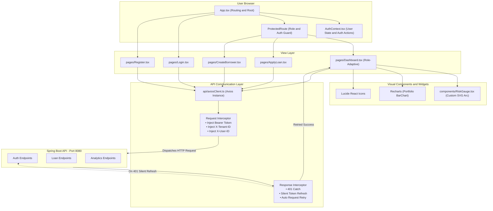

# ⚛️ AI-Powered Multi-Tenant B2B Lending Engine — Frontend Dashboard


> [!IMPORTANT]
> ### 📌 Recruiter & Reviewer Quick Links (3 Repositories)
> This enterprise platform is engineered as a decoupled polyglot microservice architecture across 3 independent repositories:
> 
> | Component | Repository Link | Role | Technology Stack |
> | :--- | :--- | :--- | :--- |
> | ⚛️ **Frontend Portal** | [**lending-engine-frontend**](https://github.com/Aryan-Raval02/lending-engine-frontend) | Glassmorphism Dashboard UI & Risk Visualizer | React 19, TypeScript, Vite, Recharts |
> | ☕ **Core Backend API** | [**lending-engine-java-api**](https://github.com/Aryan-Raval02/lending-engine-java-api) | Core Transactional Backend & Schema Multi-Tenancy | Java 21, Spring Boot 3.4, PostgreSQL, Flyway |
> | 🧠 **AI Risk Engine** | [**lending-engine-python-ml**](https://github.com/Aryan-Raval02/lending-engine-python-ml) | Real-Time Credit Scoring & ML Underwriting | Python 3.10+, FastAPI, Scikit-Learn, Pandas |

---

## 2. Short Description

The **Frontend Dashboard** of the AI-Powered Multi-Tenant B2B Lending Engine is a high-performance single-page application built with **React 19**, **TypeScript**, and **Vite**. Featuring a bespoke dark-mode **glassmorphism** design system, it delivers a role-adaptive interface tailored for both commercial **Borrowers** and financial **Loan Officers**. The dashboard features interactive SVG credit risk meters, portfolio health charts, an automated loan origination workflow, and dynamic amortization schedule generation with PDF export.

---

## 3. Demo / Screenshots

### Dual-Role Experience Overview

```
┌───────────────────────────────────────────────────────────────────────────────────┐
│  AI LENDING ENGINE ── [Tenant: Acme Corp]                          👤 John (Officer)│
├───────────────────────────────────────────────────────────────────────────────────┤
│                                                                                   │
│  ┌─ PORTFOLIO ANALYTICS ───────────────┐  ┌─ AI RISK GAUGE (Pending Loan) ──────┐ │
│  │  $12.4M Disbursed  |  42 Loans      │  │                                     │ │
│  │                                     │  │                ╭─────╮              │ │
│  │    █                                │  │               ╱  85   ╲             │ │
│  │    █      █                         │  │              (  LOW    )            │ │
│  │    █      █      █                  │  │               ╲ RISK  ╱             │ │
│  │   LOW    MED    HIGH   V.HIGH       │  │                ╰─────╯              │ │
│  │  [Portfolio Health by Risk Tier]    │  │  DSCR: 2.15 | Debt/Rev: 6.2%        │ │
│  └─────────────────────────────────────┘  └─────────────────────────────────────┘ │
│                                                                                   │
│  ┌─ PENDING LOAN APPLICATIONS ──────────────────────────────────────────────────┐ │
│  │ ID        | Borrower         | Requested  | AI Score | Risk Tier | Action    │ │
│  │ APP-8821  | Apex Logistics   | $250,000   | 85 / 100 | LOW       | [Approve] │ │
│  │ APP-9410  | CyberTech LLC    | $500,000   | 42 / 100 | HIGH      | [Review]  │ │
│  └──────────────────────────────────────────────────────────────────────────────┘ │
│                                                                                   │
│  ┌─ ACTIVE LOAN AMORTIZATION SCHEDULE ──────────────────────────────────────────┐ │
│  │ Month 1  | Due: 2026-12-20 | Principal: $9,342 | Interest: $2,604 | [PDF]    │ │
│  │ Month 2  | Due: 2027-01-20 | Principal: $9,439 | Interest: $2,506 | [PDF]    │ │
│  │ Page 1 of 4                                     [◄ Prev] [Next ►]            │ │
│  └──────────────────────────────────────────────────────────────────────────────┘ │
└───────────────────────────────────────────────────────────────────────────────────┘
```

### Visual Interface Highlights
- **Role-Adaptive Layout**: Borrowers see their active loans, apply for new credit, and view repayment calendars; Loan Officers and Tenant Admins gain underwriting approval buttons, AI factor breakdowns, and portfolio charts.
- **Interactive SVG Risk Gauge (`<RiskGauge />`)**: Custom mathematical arc gauge plotting the 0–100 AI score with color thresholds (`#10b981` Green for Low Risk, `#f59e0b` Amber for Medium, `#ef4444` Red for High/Critical).
- **Executive Analytics**: Real-time distribution bar charts powered by Recharts visualizing loan amounts categorized by underwriting risk tiers.
- **One-Click Amortization Export**: Direct browser PDF streaming and downloading generated by the backend OpenPDF engine.

---

## 4. Problem Statement

Corporate loan software in commercial banking is notorious for three significant usability and security pitfalls:

1. **Cluttered, Opaque Interfaces**: Traditional commercial banking portals present confusing tables with no intuitive visual guidance on credit approval status or AI underwriting decisions.
2. **Session Interruption & Auth Fragility**: B2B platforms often drop active user sessions when access tokens expire, wiping out multi-step loan applications mid-submission.
3. **Multi-Tenant State Leakage**: Inadequate client-side state handling can mistakenly cross-contaminate headers or cache sensitive commercial balance sheets across tenant switches.

This frontend solves these challenges with **seamless role-adaptive UX**, **automated silent token refreshing via Axios interceptors**, and **strict tenant header encapsulation (`X-Tenant-ID`)**.

---

## 5. Key Features

- **Role-Adaptive Interface**: Automatically renders specialized views based on user JWT roles:
  - **Borrowers**: Simplified credit application form, loan status tracker, paginated repayment schedule, and PDF agreement download.
  - **Loan Officers & Admins**: Portfolio distribution charts, pending application review queue, AI risk score gauges, explainability insights, and one-click loan approval/disbursement.
- **Custom Mathematical SVG Risk Gauge**: Zero-dependency dynamic arc gauge component (`<RiskGauge />`) rendering real-time credit scores (0–100) with color gradients, needle positioning, and categorical badges.
- **Resilient Silent JWT Refresh**: Custom Axios response interceptor that intercepts `401 Unauthorized` errors, invokes `/auth/refresh` with the stored refresh token, updates storage, and transparently replays the original request without user interruption.
- **Automatic Tenant & User Context Injection**: Axios request interceptors automatically inject `Authorization: Bearer <token>`, `X-Tenant-ID`, and `X-User-ID` on every API dispatch.
- **Financial Analytics Visualization**: Responsive bar charts built with `Recharts` showcasing portfolio concentration across `LOW`, `MEDIUM`, `HIGH`, and `VERY_HIGH` risk profiles.
- **Paginated Repayment Explorer**: 6-item pagination for complex 12-to-60 month amortization schedules with principal/interest breakdown and payment status badges.
- **Bespoke Glassmorphism Design System**: Built with vanilla CSS3 using `backdrop-filter: blur(16px)`, translucent gradients, glowing neon borders, and dark-mode optimization.

---

## 6. Architecture Diagram



---

## 7. Tech Stack

| Technology | Category | Version | Purpose |
| :--- | :--- | :--- | :--- |
| **React** | Core UI Library | 19.2.8 | Declarative component UI engine |
| **TypeScript** | Language | ~6.0.2 | End-to-end static typing and interface safety |
| **Vite** | Build Tool / Bundler | 8.2.0 | Next-generation ultra-fast frontend tooling |
| **React Router DOM** | Client Routing | 7.18.2 | SPA declarative route guards and navigation |
| **Axios** | HTTP Client | 1.19.0 | API communication with custom interceptors |
| **Recharts** | Data Visualization | 3.10.1 | Composable charting library for portfolio metrics |
| **Chart.js** | Charting Engine | 4.5.1 | Secondary gauge and metric visualizations |
| **Lucide React** | Iconography | 1.33.0 | Modern SVG icon system |
| **jwt-decode** | Security Utility | 4.0.0 | Client-side parsing of claims and tenant context |
| **Vanilla CSS** | Styling System | CSS3 | Custom Glassmorphism design with backdrop filters |
| **Oxlint** | Linter | 1.75.0 | High-performance Rust-based JavaScript/TypeScript linter |

---

## 8. Repository Links (3 repos)

This frontend connects to the following backend services in the 3-repository platform:

| Component | Repository Link | Description | Tech Stack |
| :--- | :--- | :--- | :--- |
| **Frontend UI** | [lending-engine-frontend](https://github.com/Aryan-Raval02/lending-engine-frontend) | React 19 glassmorphism dashboard with AI risk gauges and financial analytics | React 19, TypeScript, Vite, Recharts |
| **Core Backend** | [lending-engine-java-api](https://github.com/Aryan-Raval02/lending-engine-java-api) | Spring Boot 3 core transactional engine and schema-per-tenant routing | Java 21, Spring Boot 3, PostgreSQL, Flyway |
| **AI Risk Engine** | [lending-engine-python-ml](https://github.com/Aryan-Raval02/lending-engine-python-ml) | Python microservice for real-time credit scoring and financial feature engineering | Python, FastAPI, Scikit-Learn, Pandas |

---

## 9. Setup Instructions

### Prerequisites
- **Node.js**: Version 18.0+ or 20.0+ (`node -v`)
- **npm** (bundled with Node) or **pnpm** / **yarn**

---

### Step 1: Clone the Repository & Install Dependencies
```bash
# Navigate to the frontend directory
cd frontend

# Install all dependencies
npm install
```

---

### Step 2: Environment Configuration
Create or update the `.env` file in the root of the `frontend` folder:
```env
# Backend API Base URL
VITE_API_BASE_URL=http://localhost:8080/api/v1
```
*Note: If deployed to production (e.g., Render or AWS), point this to your live backend domain.*

---

### Step 3: Run the Development Server
```bash
npm run dev
```
Open your browser and navigate to **`http://localhost:5173`**.

---

### Step 4: Build for Production & Preview
```bash
# Typecheck and create production build in /dist
npm run build

# Preview the production build locally
npm run preview
```

### Step 5: Vercel / Cloud Deployment
This project includes a `vercel.json` file pre-configured for Single Page Application (SPA) routing:
```json
{
  "rewrites": [
    {
      "source": "/(.*)",
      "destination": "/index.html"
    }
  ]
}
```
Simply connect your GitHub repository to Vercel and it will automatically deploy using the Vite preset.

---

## 10. My Contributions

- **Engineered React 19 SPA Architecture**: Designed the modular component structure, clean routing hierarchy with protected routes, and authentication state container.
- **Crafted Custom Glassmorphism UI**: Developed a complete dark-mode design system using pure CSS3 variables and backdrop blur effects, avoiding heavyweight UI framework dependencies.
- **Built Custom SVG Risk Gauge (`<RiskGauge />`)**: Programmed dynamic circular SVG arc rendering and coordinate math to translate 0–100 credit risk scores into an intuitive visual meter.
- **Implemented Silent Token Refresh**: Configured Axios request and response interceptors to catch 401 responses, rotate JWT credentials via `/auth/refresh`, and seamlessly retry original requests.
- **Integrated Full Financial Lifecycle**: Connected loan origination forms, approval workflows, paginated amortization tables, and binary PDF schedule streaming.

---

## 11. Future Enhancements

- [ ] **Real-Time Push Notifications**: Integrate WebSockets or Server-Sent Events (SSE) to update loan officers instantly when new applications arrive.
- [ ] **Light / Dark Mode Switcher**: Implement an accessible light-mode palette toggle using CSS custom properties.
- [ ] **Document Drag-and-Drop Uploader**: Add an interactive upload interface for corporate tax returns, bank statements, and KYC documents.
- [ ] **Automated Testing Suite**: Introduce Vitest for component unit tests and Playwright for end-to-end user journey tests.
- [ ] **Internationalization (i18n)**: Support multi-currency display (USD, EUR, GBP, INR) and localized date formats.

---

## 12. Contact

**Aryan Raval** — Full-Stack & Systems Engineer  
- **GitHub**: [@Aryan-Raval02](https://github.com/Aryan-Raval02)  
- **Email**: [aryanraval299@gmail.com](mailto:aryanraval299@gmail.com)  
- **Repository**: [lending-engine-frontend](https://github.com/Aryan-Raval02/lending-engine-frontend)  
